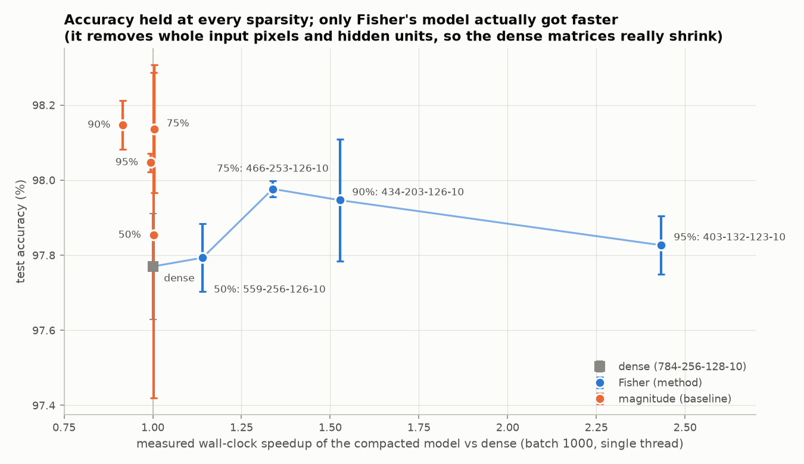
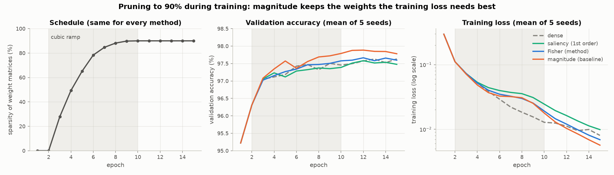
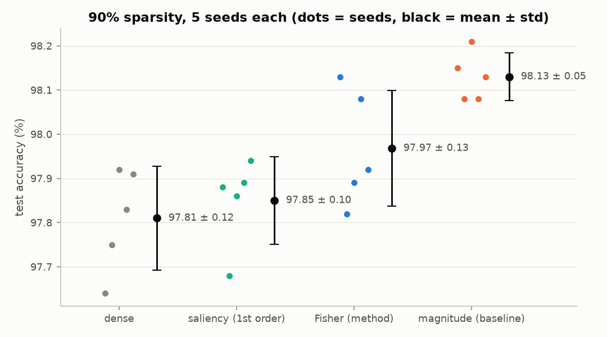
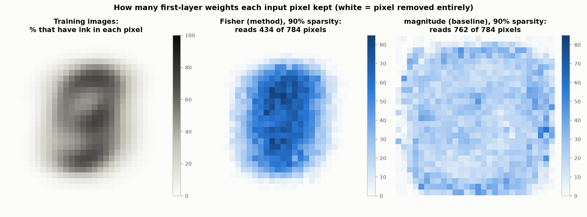
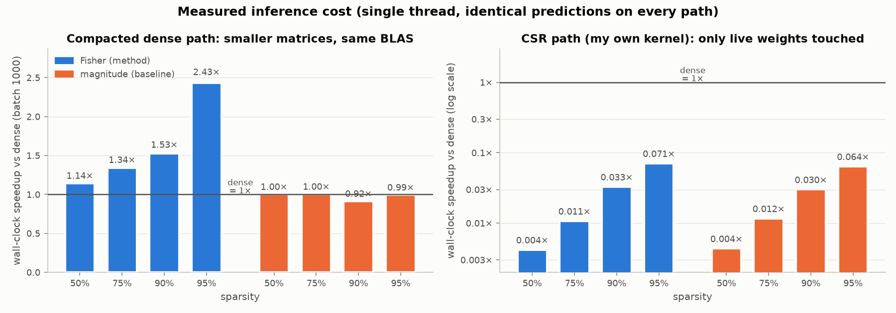

# DESIGN.md

These are my answers to the four questions in the brief, based on what I actually measured in this repo. The raw
numbers are in `results/`. If you want the story of how I got here, including the mistakes, that's in `notes.md`.

**The short version.** MNIST, a 784-256-128-10 ReLU MLP, the same 15-epoch schedule for every run, final-epoch model,
test set touched once. At 90% sparsity over 5 seeds: magnitude 98.13 ± 0.05%, Fisher 97.97 ± 0.13%, first-order
saliency 97.85 ± 0.10%, dense 97.81 ± 0.12%. Magnitude beats first-order saliency on every seed (paired −0.28 points,
t = −6.64). Fisher lands in between and isn't significantly different from either. Accuracy stays flat all the way to
95% for both Fisher and magnitude. On cost it flips: only Fisher's pruned model actually runs faster (1.53× at 90%,
2.43× at 95%, batch 1000, identical predictions), because it removes whole input pixels and hidden units. Magnitude's
doesn't (0.92× to 1.00×).



---

## 1. The importance criterion, and why it approximates "how much the loss goes up if I remove this"

### 1.1 Derivation
Removing connection *i* means setting `w_i` to 0, which is a step of `−w_i` along that one weight. Expanding the loss
around the current weights:

```
ΔL_i = L(w − w_i e_i) − L(w)
     = −g_i w_i  +  ½ w_i² H_ii  +  O(w_i³)          g_i = ∂L/∂w_i,  H_ii = ∂²L/∂w_i²
```

The `g_i` here has to be the gradient *with the connection in place*. For a live weight that's just the normal
gradient, and it's exactly what the engine stores as `dense_grad` (§2). The criterion keeps the connections with the
biggest estimated |ΔL| and drops the rest.

**First order (`saliency`).** Keep only the first term: `|ΔL_i| ≈ |w_i g_i|`. Costs one elementwise multiply per step.

**Why first order breaks down late in training.** The first term has a sign, and it depends on the full-batch
gradient. Near a minimum, `E[g_i]` goes to 0 for every weight, so `|w_i · E[g_i]|` goes to 0 everywhere and the
ranking turns into noise. That shaped two things in the code:
- I average the absolute value of the product *per minibatch*, `EMA_t |w_i g_i^(t)|`, instead of `|w_i · EMA_t g_i^(t)|`.
  By Jensen it's at least as large, and it doesn't vanish after convergence, because minibatch gradients don't go to
  zero even when their average does. There's a test for this: two minibatches whose gradients cancel for one weight,
  and that weight's score has to stay above 0.
- But at that point the score is really measuring gradient *noise*, not the first-order loss change. It's bounded by
  `sqrt(w_i² E[g_i²])`, and that's a hint to look at the second-order term instead.

**Second order (`fisher`).** Keep the curvature term. Computing the Hessian diagonal exactly is too expensive in NumPy
(an extra backward pass per weight, or a Hessian-vector product at every prune event), so I use the usual
empirical-Fisher stand-in, `H_ii ≈ F_ii = E[g_i²]`:

```
|ΔL_i| ≈ ½ w_i² E[g_i²]            score = w_i² · EMA_t (g_i^(t))²     (the ½ doesn't change the ranking)
```

Near convergence the first-order term disappears, but `E[g²]` stays positive, so this one doesn't. It uses the same
EMA decay as saliency (0.99, about 100 steps or 0.23 epoch), so the only thing that differs between the two is the
formula.

**Magnitude (the baseline).** `|w_i|`. You can read this as the second-order term if you assume `H = c·I`, i.e. every
weight matters equally per unit of size. It never looks at the data.

### 1.2 What the measurements say
| criterion (90%, 5 seeds) | test accuracy | final train loss |
|---|---|---|
| saliency `EMA|w·g|` | 97.85 ± 0.10 | ~0.010 |
| fisher `w²·EMA(g²)` | 97.97 ± 0.13 | ~0.006–0.008 |
| magnitude `|w|` | **98.13 ± 0.05** | ~0.0055 |





- **On MNIST, the criteria I derived lose to magnitude.** Saliency minus magnitude is −0.28 points, negative on all 5
  seeds, t = −6.64 (4 degrees of freedom, 5% critical value 2.78). Fisher minus magnitude is −0.16 points,
  t = −2.51: not significant, but behind or tied on all 5 seeds. Fisher minus saliency is +0.12 points, t = 2.36, also
  not significant.
- **It's a fitting problem, not a generalisation problem.** The three criteria rank the same way on *training* loss as
  they do on test accuracy. Saliency is throwing away weights the training loss actually needed. Second order gets
  some of that back, in the direction the derivation says it should.
- **My best explanation is memory length.** Under Adam, a weight's size is the sum of thousands of updates, so `|w|`
  carries the whole training history: a weight is big because its gradient kept pointing the same way for a long
  time. The EMA criteria only remember about 100 steps. Late in the ramp, training loss is around 0.02 and each
  batch's gradient is mostly noise from a handful of hard examples, so that short memory hurts. Magnitude remembers the
  whole run; saliency only remembers the last quarter of an epoch. I deliberately didn't try a longer window, because
  changing it after seeing the result would have been tuning to the outcome.
- **Where the data-aware criteria do win is structure.** Pixels that are almost always 0 produce almost no gradient,
  so every weight attached to them scores about 0 under saliency or Fisher. Magnitude can't tell; those weights just
  keep their random starting size. At 90%, Fisher drops 350 of the 784 inputs completely, and magnitude drops 22.
  That's what makes Fisher's model cheaper to run (§3.2). There's a unit test for the same effect: on always-zero
  inputs, saliency removes every such weight and magnitude keeps some.

  
- **Disclosure.** I made Fisher "the method" *after* seeing the 90% comparison. My reasons were that it's the term
  the derivation points to late in training, and it was never clearly worse than first order. Magnitude was the
  baseline from start to finish, and I didn't swap the labels. But it does mean the Fisher results in the Pareto sweep
  aren't an independent confirmation.

### 1.3 Schedule and allocation
- **Cubic ramp**, `s(t) = s_f (1 − (1 − u)³)`, where `u` is how far through the ramp we are. It cuts fastest at the
  start, when the network has the most redundancy, and slows to zero at the end, when every remaining weight matters
  and the network needs time to re-route. Every run uses the same schedule: 15 epochs; epochs 0–2 dense (at init every
  criterion's scores are noise); epochs 2–10 the ramp, with masks updated every 100 steps (35 prune events); epochs
  10–15 fine-tuning with the masks frozen at exactly the target. I didn't do one-shot pruning at the end, because it
  gives the network no time to adapt. I also didn't start pruning from the best-validation checkpoint at epoch 10,
  because that would mean using validation to choose the starting point, and it breaks my rule of always reporting
  the final-epoch model.
- **One global ranking, with a per-layer floor.** Saliency and Fisher are in loss units, so it's fair to compare them
  across layers. The floor, `min(5%, (1 − s)/2)` rounded down, stops a global cut from emptying the 1,280-weight output
  layer. Capping it at half the remaining density turned out to matter. At 95%, a flat 5% floor would have forced
  every layer to exactly 5%, which quietly turns a global ranking into uniform per-layer pruning. I only found this
  because the 95% runs crashed on an off-by-one in how the floor was rounded. Every criterion uses the same
  allocation.
- **Hard budget.** The number of weights kept is an integer, hit exactly at the end of the ramp and held through
  fine-tuning (tested). I report the sparsity measured from the masks, not the target I asked for.

### 1.4 Regrowth and stability
I wrote the rule down in `notes.md` before running anything. Every epoch after warmup, I **swap**
`k = max(10% of the weights pruned that epoch, 0.5% of the live weights)`: bring back the dead weights with the largest
`EMA|dense_grad|`, and prune the same number of the lowest-scoring live ones, so sparsity stays on schedule.
- **Dead weights are ranked by `|g|`.** A revived weight comes back at 0, so its `|w·g|` or `w²E[g²]` is 0 no matter
  what. What matters is how fast the loss would drop if it were allowed to move, and to first order that's `|g|`.
- **It comes back at 0, with fresh Adam state and its own step count** (§2.1). Its first update is about `lr·sign(g)`:
  bounded, in the direction the current gradient wants, and with no spike that depends on when it came back.
- **One epoch of grace.** Without it, a revived weight scores 0 at the very next prune event and gets removed straight
  away, so regrowth would silently do nothing. I tested it both with and without.
- **Result: no effect.** Same 90% target, same seeds, same schedule; the only change is `--regrow`
  (`results/part3/fisher{,-regrow}_s90_seed*.json`, paired test in `results/part3/summary.json`):

  | seed | 0 | 1 | 2 | 3 | 4 | mean ± std |
  |---|---|---|---|---|---|---|
  | fisher | 98.13 | 97.82 | 97.89 | 98.08 | 97.92 | 97.97 ± 0.13 |
  | fisher + regrowth | 98.38 | 97.87 | 97.78 | 97.97 | 98.01 | 98.00 ± 0.23 |
  | difference (points) | +0.25 | +0.05 | −0.11 | −0.11 | +0.09 | **+0.03 ± 0.15, t = 0.50** |

  Not significant (critical value 2.78), better on 3 seeds out of 5, and noisier. The run logs show why: about 21.8k
  revivals over 13 swaps, but only around 480 revived weights (2% of the final network) were still alive at the end.
  The rule is lopsided. A weight gets back in because its `|g|` is large, but from then on it's judged on `w²E[g²]`,
  against weights that have been growing for 10 epochs, so it loses. With this rule, regrowth mostly just churns. Things
  that might fix it, none of which I ran so as not to tune to the outcome: a longer grace period, reviving at a
  non-zero value, or judging revived weights only against each other.

---

## 2. What is "the gradient of a masked weight"?
In one sentence: **the optimizer sees `grad = mask ⊙ ∂L/∂w_eff`, which is the true derivative with respect to the
stored weight and exactly 0 where it's pruned; a separate field, `dense_grad = ∂L/∂w_eff`, keeps the pre-mask signal
for saliency and regrowth and never reaches the optimizer.**

In the forward pass, `w_eff = where(mask, w, 0)`, so a pruned weight is a real zero. I use `where` and not `w*mask`
because `nan*0 = nan`: if a pruned slot ever held garbage, multiplying by zero would poison the output. Tested with
1e30, inf and nan in pruned slots.

| name | value | who uses it | why |
|---|---|---|---|
| `p.grad` | `mask ⊙ g` | the optimizer | by the chain rule, `w_eff` doesn't depend on a pruned `w`, so the derivative is 0. That's exact, not an approximation. |
| `p.dense_grad` | `g` | saliency `|w·g|` and Fisher `w²g²` for live weights; regrowth `|g|` for dead ones | answers "what would the loss do if this connection existed?" |

Why I think this is right: the two answer different questions, and mixing them up breaks things in both directions.
Feed `dense_grad` to the optimizer, and pruned weights move and have to be forced back to zero, which corrupts their
momentum. Use `grad` for regrowth, and dead weights look dead forever. The mask is also snapshotted at forward time,
so calling `set_mask` between forward and backward can't change a graph that's already in flight (test `d7`).

### 2.1 What Adam does with pruned and revived weights
I **drop** the state. While a weight is masked, `m = v = t = 0`. If it comes back, it starts from scratch with **its
own step count** (`t = 1`, so its first update is about `lr·sign(g)`), and its value starts at 0.
- Keeping the old moments instead (ablation flag `reset_state_on_mask_change=False`): in `test_d4` the revived weight
  moves **uphill** (−5.6e-3 instead of the correct +1.0e-2), because the momentum from before it was pruned overrides
  the current gradient.
- Zeroing the moments but keeping one global `t`: the first update is `3.16·lr` once `t ≥ 1e4` (0.74× at t = 56, 2.5×
  at t = 1000). That's a spike whose size depends on *when* the weight comes back. A per-weight `t` gets rid of it.
- If a weight is pruned and revived between two optimizer steps, comparing the mask before and after (XOR) misses it.
  `Parameter` records every change (`consume_mask_changes`), so the state still gets reset (`test_d5`).
- As a safety net, pruned values are set back to zero after every step. Mutation testing showed my first test suite
  never actually exercised this, so I added `test_d9`.

### 2.2 The derivations underneath
- `(N,D) + (D,)`: the bias is broadcast across N rows, so `∂L/∂b = Σ_n G[n,:]`. `_unbroadcast` sums over prepended
  axes and size-1 axes.
- `Y = A B`: `∂L/∂A = G Bᵀ` and `∂L/∂B = Aᵀ G`.
- Softmax with cross-entropy, fused: `∂L/∂z = (softmax(z) − onehot(y)) / N`, with the forward pass done through
  log-sum-exp. It's stable for logits of 1000, where plain softmax overflows (tested).
- Masked weight: `w_eff = m·w` elementwise, so `∂L/∂w = m ⊙ ∂L/∂w_eff`.

---

## 3. Where the autodiff engine is slow, and how I'd speed it up

### 3.1 A training step (measured: 1 thread, batch 128, 784-256-128-10, Fisher scoring on)
| part | ms/step | share |
|---|---|---|
| forward | 1.99 | 18% |
| backward | 2.96 | 27% |
| Adam | 5.12 | 47% |
| Fisher scoring (`observe`) | 0.74 | 7% |
| zero_grad | 0.17 | 2% |
| **total** | **10.98** | |
| just the 9 matrix multiplies this step needs | 1.62 | |

The matrix multiplies are only about 15% of the step. Everything else is overhead:
- **Adam is the biggest single cost.** It takes 5.1 ms per step inside the training loop, but only 2.4 ms when I run
  the same `step()` on its own. The mask bookkeeping (re-zeroing and clearing state) is 0.09 ms, so that's not it.
  - *What I measured:* the per-weight bias correction, which is what makes revival correct (§2.1). Every step, for
    every parameter, Adam updates two full-size float64 arrays `β1^t, β2^t` (running products; I'd already replaced
    the original `β**t` power in Step 2), computes `1/(1−β1^t)` and `1/(1−β2^t)` as full arrays, and casts them to
    float32. Timed on its own, that's **0.9 ms of Adam's ~2.4 ms**, more than the moment updates (0.36 ms) and the
    final update (0.25 ms) put together. With one global `t` it would be two scalars.
  - *What I think, but haven't measured:* the extra 2.7 ms inside the loop is memory traffic. For every weight, Adam
    reads and writes `data, grad, m, v, t (int64), β1^t, β2^t (float64)` plus temporaries, which is about 24 bytes more
    than textbook Adam, and inside the loop those arrays fight with activations and gradients for cache. I haven't
    confirmed this with hardware counters, so treat it as a hypothesis.
- **Python overhead in the graph.** Every op creates a `Tensor`, a closure and new output arrays, and `backward` walks
  a topological order in Python. That's fine for an MLP with about 10 nodes, but it would dominate a deep graph of
  small ops.
- **NumPy temporaries.** Every elementwise expression allocates a new array (`m*b1 + (1-b1)*g` makes three). Backward
  allocates a new array for every gradient and then adds it in with `+=`.
- **The cost of masking.** `where(mask, w, 0)` copies every weight matrix on every forward pass, and `dense_grad` is a
  second full-size gradient accumulated on every step, even though it's only needed while scoring.

What I'd do about it, in order:
1. **Make the bias correction cheap.** Use one global `t` (two scalars) for weights that have never been revived, and
   keep per-weight `t` only for recently revived ones, in a small side table. After about 1/(1−β2) ≈ 1000 steps a
   revived weight's correction is ≈1 and it can go back to the global path. Revival stays just as correct, and the
   0.9 ms of full-array work shrinks to roughly the size of the revived set. After that, fuse the rest of Adam into one
   pass per parameter (a compiled kernel, or in NumPy at least `out=` buffers so there are no temporaries).
2. **Allocate once and update in place.** Reuse gradient buffers, Adam temporaries and the masked-weight buffer across
   steps (`np.multiply(..., out=)`), so nothing is allocated per step.
3. **Fuse `linear + bias + relu`** into one op for both forward and backward: one node instead of three, and one
   temporary instead of three.
4. **Only compute `dense_grad` when something needs it**: on scoring steps, and not at all during fine-tuning without
   regrowth. The rest of the time, backward only writes `grad`.
5. Cache `w_eff` between mask changes instead of recomputing `where` on every forward.
6. **For inference in NumPy, run the compacted dense model, not CSR.** From §3.2: compaction is 1.53× faster than
   dense at 90% (Fisher), while CSR is about 30× slower despite doing 10× fewer multiply-adds. CSR only pays off with a
   compiled sparse kernel, or with structured (block or 2:4) sparsity that the hardware supports.

### 3.2 Inference: sparse doesn't automatically mean fast (measured, Part 4)
I timed three versions of each saved model, single-threaded on the MNIST test set, and checked that all three give
identical predictions (`results/part4/cost.json`):
- **dense**: `x @ where(mask, W, 0)`. This is the dense-times-zeros shortcut: it does exactly as much work as the
  unpruned model, so it's **not a speedup**.
- **compact**: drop the inputs no live weight reads, plus hidden units with no inputs (their constant output
  `relu(b)` gets folded into the next layer's bias) or no outputs. What's left is smaller dense matrices on the same
  BLAS.
- **csr**: compact, then my own CSR kernel (gather the live inputs for each output, multiply, sum per segment). The
  work is proportional to the live weights only.

| model (batch 1000) | multiply-adds per image: dense / compact / csr | compact vs dense | csr vs dense |
|---|---|---|---|
| fisher 50% | 234,752 / 176,620 / 117,376 | 1.14× | 0.004× |
| fisher 75% | 234,752 / 151,036 / 58,688 | 1.34× | 0.011× |
| fisher 90% | 234,752 / 114,940 / 23,475 | **1.53×** | 0.033× |
| fisher 95% | 234,752 / 70,662 / 11,738 | **2.43×** | 0.071× |
| magnitude 50% | 234,752 / 234,752 / 117,376 | 1.00× | 0.004× |
| magnitude 75% | 234,752 / 234,752 / 58,688 | 1.00× | 0.012× |
| magnitude 90% | 234,752 / 228,854 / 23,452 | 0.92× | 0.030× |
| magnitude 95% | 234,752 / 209,850 / 11,717 | 0.99× | 0.064× |



- **In NumPy, unstructured sparsity doesn't save any time.** CSR does 10× fewer multiply-adds at 90% and is still
  about 30× slower than dense at batch 1000 (and slower at batch 1 too). The gather builds an `(N × nnz)` array, and
  BLAS is far better at dense matrix multiplies than NumPy is at gather-and-sum. The reduction in arithmetic is real;
  the speedup just isn't there on this stack.
- **What pays off is removing structure.** After compaction, Fisher's 90% model is 434-203-126-10: 1.53× faster, same
  predictions. Magnitude's is 762-256-127-10: barely smaller, and copying the kept inputs makes it slightly slower
  (0.92×). At 50% and 75% magnitude removes no input or unit at all, so compaction does nothing (1.00×).
- **How it's timed.** Dense and compact are measured round-robin (each repeat times both back to back, median of
  15), after a 3-second CPU warm-up; CSR is timed separately. The ratios matter more than the absolute times, which
  drifted by up to ±20% on identical work while I was measuring.
- My first versions of this benchmark had four bugs, and the 0% row (dense and compact are the same network there,
  so they must time at 1.00×) caught every one. At 0% sparsity, dense and compact are
  the same network, so they have to come out at 1.00×. (1) The dense path re-applied the mask on every call, which made dense look 5×
  slower than it is. (2) The compacted matrices weren't contiguous after column slicing. (3) Timing each path in its own
  block let machine drift land on one path and not another (0% row read 1.13×). (4) After switching to round-robin, CSR
  sat in the same rotation, and its ~1 GB temporary evicted the caches right before dense ran (0% row read 1.20×).
  With all four fixed the 0% row reads 0.99–1.04× and magnitude 50/75% (nothing removable) read exactly 1.00×.

---

## 4. Serving a self-pruned model in a multi-tenant service at thousands of requests per second

**What I'd ship, given what I measured.** In this stack only *structural* pruning gave a real speedup, so the thing I'd
deploy is the **compacted dense model** (smaller matrices, plain matrix multiplies), not the CSR one. Unstructured CSR
only becomes worth it with a proper sparse kernel (compiled, SIMD, ideally the 2:4 or block sparsity the hardware
supports) and at sparsity well above 90%, and I'd want to measure that before believing it. If I were training for
deployment, I'd change what gets pruned to match: score and remove *blocks or neurons* (scores summed per row, column
or block), so the accuracy-vs-cost trade-off is measured on the thing that actually gets faster.

**Artifacts and versioning.**
- Export immutable, versioned artifacts: the compacted weights, which inputs and units were kept, the folded biases,
  and metadata (training commit, seed, sparsity, layer shapes, eval accuracy, BLAS build). Hash the contents so a
  rollback is just moving a pointer.
- Gate every release on the same evaluation I used here: accuracy on held-out data against the dense parent and the
  previous version, plus measured p50 and p99 latency on the real hardware. A pruned model that isn't actually faster
  doesn't ship.
- Keep the dense parent around as a fallback for every pruned version.

**Multiple tenants.**
- Tenants usually share a base model and differ in fine-tuning. Pruning changes the *shape* (compacted sizes differ
  from model to model), and models with different shapes can't share one batched matrix multiply. My first choice is
  to share one structure across tenants and only let the weights differ (prune once, then fine-tune each tenant under
  a fixed mask), so requests from many tenants batch into the same kernel. Failing that, group tenants by structure.
- Keep hot models in memory and load cold ones on demand, with an LRU cache of decoded artifacts. Compacted models are
  small (Fisher at 90% is about 24k weights here), so thousands of them fit. What costs money is the work per request,
  not storage.
- Isolation: per-tenant concurrency limits and queues, so one tenant's burst can't eat another tenant's latency
  budget, and separate pools for very large or very noisy tenants.

**Throughput and latency.**
- Dynamic batching with a short maximum wait (a few milliseconds) per structure group. At batch 1000, the compacted
  Fisher 90% model ran in 3.3 ms single-threaded against 5.0 ms for dense, so the speedup holds up under batching. At
  batch 1 it's 0.023 ms against 0.033 ms, where per-request overhead dominates anyway.
- Pin BLAS threads per worker and scale out with processes. It's the same lesson as my reproducibility bug:
  oversubscribed BLAS threads change both the latency and the numbers.
- A p99 latency target per tenant, with load shedding, and a fallback to a cheaper or cached path when queues grow.

**Monitoring.**
- Per tenant and per model version: latency, throughput, error rate, input statistics, and how the pruned model's
  predictions compare to the dense parent on a sample of shadow traffic.
- The specific risk with a pruned model is accuracy drift. This one kept its accuracy on data like its training
  data, but it threw away inputs it decided were useless: Fisher dropped 350 pixels that were almost always 0 *in
  training*. If production inputs start using those regions (different crops, different devices, shifted data), the
  pruned model can't see them and the dense one can. So I'd track how much input signal lands on pruned inputs, and
  regularly run the dense parent on a sample to measure how often the two disagree. If it drifts: alert, fall back to
  dense, then re-prune on fresh data.

---

## Appendix A — Step 2 decisions: architecture, init, dtype, protocol
**Architecture.** 784-256-128-10 with ReLU: 235,146 parameters, of which 234,752 (99.83%) are prunable weights. The
394 biases are never pruned. At 95% sparsity, 11,738 weights are left. One activation (ReLU) means one init (He).

**Init.** For z = Σ_i w_i x_i with zero-mean independent weights, Var(z) = n_in · Var(w) · E[x²]. If x = relu(z_prev)
and z_prev is symmetric around 0, then E[x²] = Var(z_prev)/2, so keeping Var(z) constant needs **Var(w) = 2/n_in (He)**.
The output layer has no ReLU after it, so the factor of 2 doesn't apply there: **Var(w) = 1/n_in** (LeCun, gain 1).
Biases start at 0. I measured E[h²] through 8 ReLU layers of width 512 (`python -m train.init_study`,
`results/init_study.json`): with He it stays around 0.3 (max/min under 1.6); gain 1 under ReLU halves it at every layer
(1.5e-1 → 1.3e-3); N(0, 0.01²) collapses to 4e-14; N(0, 0.1²) blows up to 4e2. On the real architecture the initial
loss is about ln(10) (tested). One caveat: fan-in scaling only preserves the *forward* variance, but Adam's
per-weight normalisation makes the backward mismatch mostly irrelevant.
**After pruning** (something I flagged to watch in Step 2), measured on validation at 90%, seed 0: hidden E[h²] drops
from 0.78 to 0.33–0.45 in layer 1, and from 8.3 to 4.3 in layer 2. So activations do shrink, by roughly 40–60%, even
though about 93% of layer 1's inputs are gone. Training makes up the rest. Accuracy isn't affected, so I didn't add
any rescaling.

**dtype: train in float32, gradient-check in float64, and keep the two separate.** Measured on 1 core at batch 128:
float64 13.1 ms per step, float32 6.3 ms. The 1e-6 finite-difference tolerance only makes sense in float64. I check
float32 differently: a float32 model and a float64 model with the same (rounded) init must produce gradients within
1e-4 relative L2 error, and no tensor is allowed to silently upcast (`tests/test_nn.py`).

**Protocol.** MNIST in its standard order: the last 10k images are the test set, touched once at the very end, on the
final-epoch model, with no checkpoint picking. The first 60k are shuffled with a *fixed split seed* into 55k train and
5k validation. The model seed (init and batch order) is separate, so seed-to-seed variation measures training
randomness, not a different dataset. Same seed means same init and same batch order, which is why I compare methods
**paired by seed**.

## Appendix B — How I checked the tests, and known limits
- I fixed the gradient-check threshold before running anything: `|a−n| ≤ 1e-8 + 1e-6·max(|a|,|n|)`, float64, ε = 1e-6.
- `test_gradcheck_sensitivity.py` plants three classic bugs (missing batch sum, overwriting instead of accumulating,
  wrong sign) and requires the gradient check to catch them. I also mutated the real code (`w*mask`, optimizer fed
  `dense_grad`, no moment reset, no unbroadcast on either side, overwrite instead of accumulate, bias folding removed
  from compaction), and each mutation turns at least one test red.
- `matmul` and `transpose` only handle 2-D arrays; anything else raises. The ReLU subgradient at exactly 0 is 0, so
  gradient-check inputs are kept at least 0.1 away from the kink.

## Appendix C — Reproducibility
- Every `python -m train.*` entry point pins BLAS to 1 thread before NumPy loads (`train/__init__.py`). Here's why:
  Fisher at 90%, seed 0, gives 98.13% single-threaded and 98.08% with Accelerate's default threading. A different
  thread count changes the order floats are summed in, and over about 6,000 steps that's enough to land on a different
  model. With the pin, reruns are bit-identical: every saved model in `results/part4/models` reproduces its
  `results/part3` number exactly.
- That holds on the same BLAS build. On a different one (OpenBLAS, MKL), expect differences in the last digits, well
  within the seed-to-seed spread.
- `fetch_openml` is called with `parser="liac-arff"`. The default parser needs pandas, which Colab has and a clean
  `requirements.txt` install doesn't.
