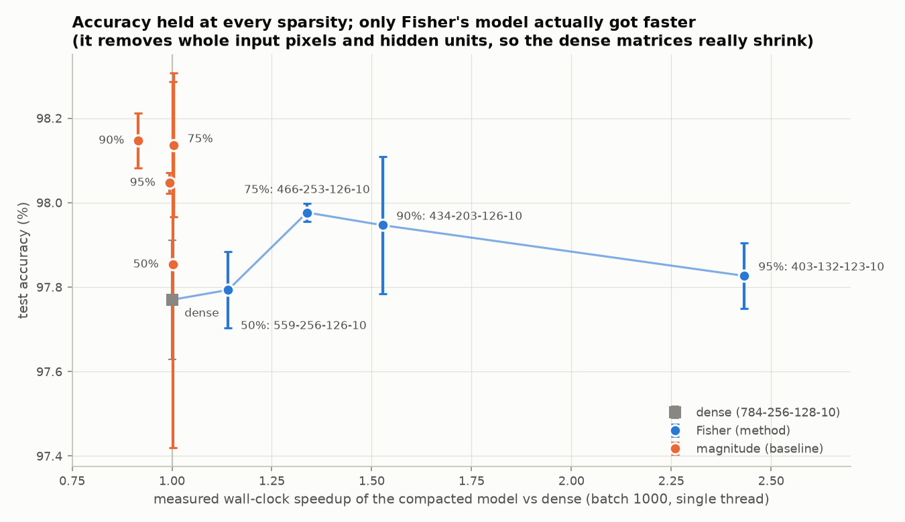
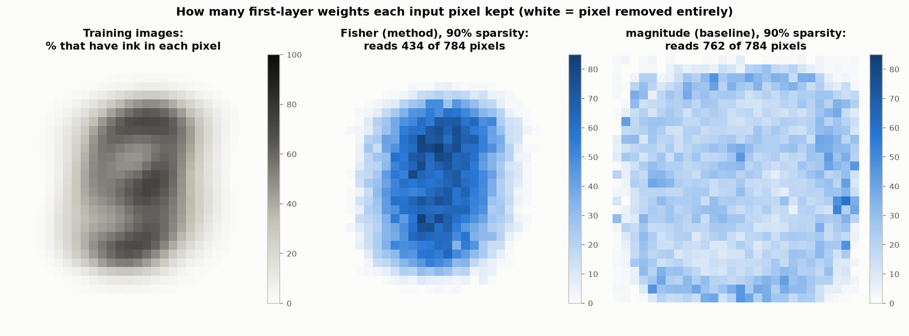

# AQUA — The Self-Pruning Network

A reverse-mode autodiff engine written from scratch in NumPy, and an MLP built on it that removes 90–95% of its own
connections while it trains, keeps its accuracy, and (with the right criterion) actually runs faster.



## What I did
1. **Autodiff engine** (`engine/`): tensors, broadcasting-correct backward, fused softmax + cross-entropy,
   finite-difference gradient checks for every op. Masked weights are real zeros, and the engine keeps two gradients:
   `grad` (exactly 0 where pruned, the only one the optimizer sees) and `dense_grad` (used to score connections).
   Adam drops the state of pruned weights and restarts revived ones cleanly with their own step count.
2. **Training** (`nn/`, `train/`): 784-256-128-10 ReLU MLP on MNIST, He/LeCun init, Adam, mini-batch loop. Dense
   baseline: 97.87% test after 20 epochs, no NaNs ([learning curve](results/part2_mnist_seed0_curve.png)).
3. **Self-pruning** (`prune/`): three importance criteria behind one interface: first-order saliency `|w·g|`,
   second-order Fisher `w²·E[g²]` (the method), and magnitude `|w|` (the baseline). A cubic schedule ramps sparsity up
   during training, global ranking with a per-layer floor allocates it, and the target is hit exactly. Optional
   regrowth swaps weights back in, with a grace period.
4. **Evidence**: 5-seed paired comparison at 90%, a Pareto sweep from 0 to 95%, and a real cost measurement using my
   own sparse inference paths (compaction and a CSR kernel), with every path checked to give identical predictions.

## What came out
| at 90% sparsity, 5 seeds | test accuracy | weights kept |
|---|---|---|
| dense (same 15-epoch schedule) | 97.81 ± 0.12% | 234,752 |
| saliency `|w·g|` | 97.85 ± 0.10% | 23,475 |
| Fisher `w²·E[g²]` (method) | 97.97 ± 0.13% | 23,475 |
| magnitude `|w|` (baseline) | **98.13 ± 0.05%** | 23,475 |

- **Accuracy holds.** With 90% of the weights gone, nothing is lost against dense, and accuracy stays flat out to 95%.
- **Falsifiable claim:** at 90% sparsity, magnitude keeps 98.13 ± 0.05% vs 97.85 ± 0.10% for first-order saliency,
  over 5 seeds; paired difference −0.28 points, negative on 5/5 seeds, t = −6.64. On accuracy, my importance-based
  criteria do **not** beat magnitude here (Fisher vs magnitude: −0.16 points, t = −2.51, not significant).
- **Only Fisher's model got faster.** It removes whole input pixels and hidden units, so the 90% model compacts to
  434-203-126-10 and runs **1.53× faster** than dense (2.43× at 95%) with identical predictions. Magnitude's barely
  shrinks (762-256-127-10, 0.92×). My CSR kernel does 10× fewer multiply-adds but is slower than dense BLAS: in NumPy,
  unstructured sparsity isn't a speedup.
- **Regrowth** works mechanically but made no difference at 90% (+0.03 points, t = 0.50).



## How it works, in short
- Removing a weight changes the loss by `ΔL ≈ −g·w + ½·H·w²`. Saliency keeps the first term; it fades near
  convergence because the average gradient goes to 0. Fisher keeps the second term, using `E[g²]` for the curvature.
- Pruning happens during training: 2 epochs dense, a cubic ramp from epoch 2 to 10 (masks updated every 100 steps),
  then 5 epochs of fine-tuning with the masks frozen. Every run uses the same schedule, reports the final-epoch model,
  and touches the test set once.
- Pixels that are almost always blank get almost no gradient, so Fisher scores their weights as worthless and the
  whole pixel disappears. That's where the real speedup comes from.

Full derivations and the four design questions are in **[DESIGN.md](DESIGN.md)**. **[notes.md](notes.md)** is my
working log, kept step by step: what I expected, what happened, the bugs I hit, and why I decided each thing.

## Run it
scikit-learn is used **only** to download and load MNIST (`train/data.py`). Everything else (autodiff, backward,
optimizer, masking, pruning, training loop) is my own code; no PyTorch, TensorFlow, JAX or other NN library.

```bash
uv venv --python 3.12 && uv pip install -r requirements.txt          # or pip install -r requirements.txt (Python >= 3.10)
python -m pytest -q                                                   # all tests
python -m pytest -q tests/test_gradcheck.py tests/test_masked.py      # Part 1: gradient checks + masked-weight test
python -m train.train_dense --dataset mnist --epochs 20 --seed 0      # Part 2: dense training + learning curve
python -m train.train_prune --target 0.9 --criterion fisher --seed 0  # Part 3: one self-pruning run
python -m train.sweep --targets 0 0.5 0.75 0.9 0.95 --criteria fisher magnitude --seeds 0 1 2 --jobs 6 && python -m train.pareto   # Part 4: Pareto sweep
python -m train.sweep --targets 0 0.9 --criteria saliency fisher magnitude --seeds 0 1 2 3 4 --jobs 6 && python -m train.summarize  # 90% claim, paired tests
python -m train.sweep --targets 0 0.5 0.75 0.9 0.95 --criteria fisher magnitude --seeds 0 --out results/part4 --save-model --jobs 6 \
  && python -m train.bench_cost --models results/part4/models/*.npz   # Part 4: cost (batch 1 / 32 / 1000, single thread)
python -m train.figures                                               # redraw every figure from the committed results
```
Every command pins BLAS to one thread (the thread count changes float summation order, and therefore the final model),
so results reproduce bit for bit on the same BLAS build. The first run downloads MNIST once into `data/`.

```
engine/   autodiff: Tensor, masked Parameter, ops, gradcheck        prune/    criteria, cubic schedule, mask manager, regrowth
nn/       layers, mask-aware Adam, sparse inference paths           train/    data, loop, run scripts, sweep, Pareto, cost, figures
tests/    109 tests: grad checks, masking, pruning, sparse path      results/  every raw number and plot quoted above
```
